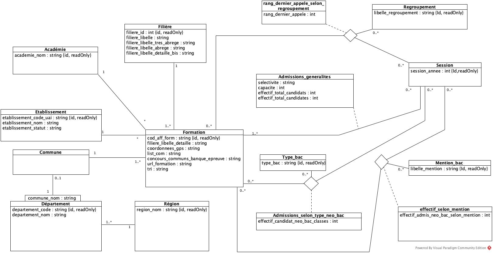

# Base de données Parcoursup (SAÉ 2.04)

Projet réalisé en binôme pendant la première année de BUT Informatique à l'IUT de Lannion (2025-2026).

L'objectif : construire une base de données PostgreSQL à partir des données ouvertes Parcoursup de la session 2022 (jeu de données `fr-esr-parcoursup`, publié par le ministère de l'Enseignement supérieur). Le fichier CSV d'origine est une seule grande table. On la découpe en plusieurs tables liées entre elles.

## Modèle de données

Le schéma `parcoursup2` contient 15 tables :

- **Lieux** : `_region`, `_academie`, `_departement`, `_commune`, `_etablissement`
- **Formations** : `_filiere`, `_formation`, `_session`
- **Types de candidats** : `_type_bac`, `_mention_bac`, `_regroupement`
- **Résultats d'admission** : `_admissions_generalites`, `_admissions_selon_type_neo_bac`, `_effectif_selon_mention`, `_rang_dernier_appele_selon_regroupement`

Le diagramme de classes UML du modèle :

## Contenu du dépôt

| Fichier | Rôle |
|---|---|
| `create_parcoursup2_db.sql` | Crée le schéma `parcoursup2` et ses tables |
| `populate_parcoursup2_db.sql` | Charge le CSV dans une table temporaire, puis remplit chaque table |
| `parcoursup_db_create_b24.sql` | Script de création du schéma `parcoursup` |
| `fr-esr-parcoursup_2022.csv` | Données Parcoursup 2022 |
| `dico_data_toute_annee.xlsx` | Dictionnaire des données |
| `proprietes.txt` | Liste des attributs à utiliser dans la base |
| `ParcourSup_simple.jpg` | Diagramme UML |

## Analyse statistique (partie 3)

À partir de la base, j'ai extrait les formations des Côtes-d'Armor (vue SQL `vue_sae`), puis analysé les données en Python : moyennes, variances, boîtes à moustaches, nuages de points et régression linéaire multiple. Le modèle explique environ 93 % de la variation du nombre de candidats.

Tout est dans le dossier [`analyse/`](analyse/), avec son propre [README](analyse/README.md).

## Utilisation

Prérequis : PostgreSQL et [SQL Workbench/J](https://www.sql-workbench.eu/) (le script de remplissage utilise sa commande `WbImport`).

1. Créer la base : exécuter `create_parcoursup2_db.sql` dans un client SQL connecté à PostgreSQL.
2. Remplir la base : ouvrir `populate_parcoursup2_db.sql` dans SQL Workbench/J, depuis le dossier du dépôt (le CSV est lu avec un chemin relatif, avec `;` comme séparateur) et l'exécuter.

## Ce que le projet m'a appris

- Concevoir un modèle relationnel : clés primaires, clés étrangères, tables d'association.
- Passer d'un modèle UML à un schéma SQL.
- Importer un gros fichier CSV dans une table temporaire, puis répartir les données avec des `INSERT ... SELECT DISTINCT`.

## Auteur

Evan Cariou - BUT Informatique, IUT de Lannion
