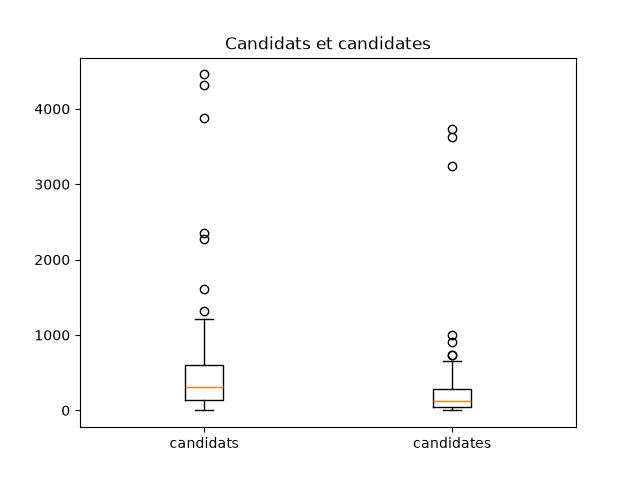
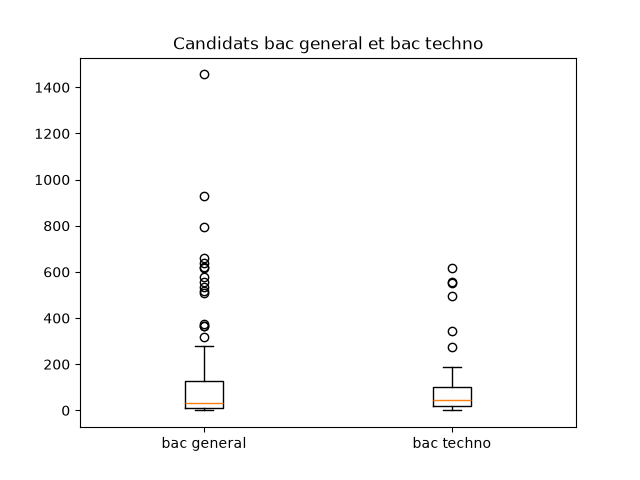
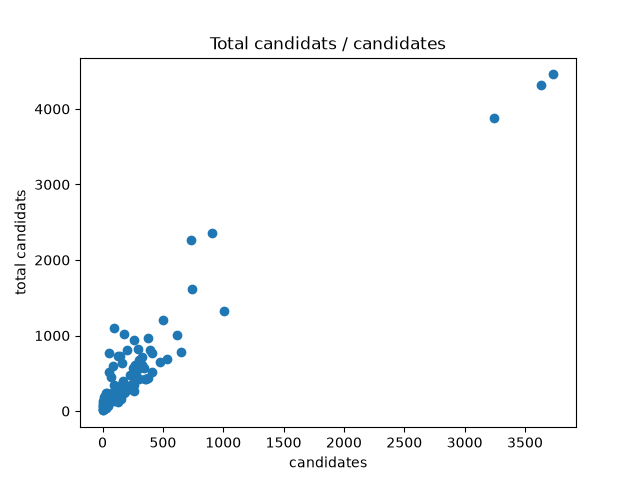
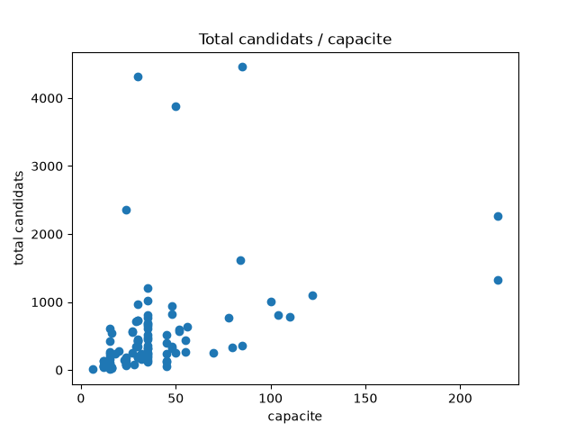

# Partie 3 : analyse statistique

Cette partie étudie les formations Parcoursup 2022 des Côtes-d'Armor (département 22) : 105 formations au total. La question : qu'est-ce qui explique le nombre total de candidats d'une formation ?

## Les variables

| Variable | Colonne du CSV | Rôle |
|---|---|---|
| Nombre total de candidats | `effectif_total_candidats` | Y, la variable à expliquer |
| Capacité d'accueil | `capacite` | X1 |
| Nombre de candidates (filles) | `effectif_total_candidates` | X2 |
| Candidats néo-bacheliers de bac général | `nb_bac_general` | X3 |
| Candidats néo-bacheliers de bac technologique | `nb_bac_techno` | X4 |

## Fichiers

| Fichier | Rôle |
|---|---|
| `vue_sae.sql` | Crée la vue `vue_sae` dans la base `parcoursup2` (jointures sur les tables d'admission, filtre sur le département 22) et l'exporte en CSV |
| `ParcoursupCotesArmor.csv` | Résultat de la vue : 105 lignes, 5 colonnes |
| `analyse_sae.py` | Calculs statistiques et graphiques |
| `*.png` | Graphiques produits par le script |

## Ce que fait le script

- Calcule la moyenne, la variance et la covariance avec des fonctions écrites à la main.
- Trace deux boîtes à moustaches (candidats / candidates, bac général / bac techno) et deux nuages de points (candidats en fonction des candidates, puis de la capacité).
- Calcule une régression linéaire multiple avec la formule du cours, (tX X)^-1 tX Y. Les produits de matrices sont faits avec des boucles, seule l'inversion utilise `numpy.linalg.inv`.
- Calcule le coefficient de corrélation multiple R, entre le vrai nombre de candidats et celui estimé par le modèle.

## Résultats

Modèle obtenu :

```
candidats = 105,33 - 0,289 x capacite + 0,896 x candidates + 0,631 x bac_general + 1,205 x bac_techno
```

Le coefficient de corrélation multiple vaut R = 0,966, soit R² = 0,933. Le modèle explique donc environ 93 % de la variation du nombre de candidats entre les formations.

| Variable | Moyenne | Variance |
|---|---|---|
| Capacité | 39,2 | 1121,0 |
| Total candidats | 528,8 | 571452,6 |
| Candidates | 283,0 | 350881,0 |
| Bac général | 136,0 | 55622,9 |
| Bac techno | 79,1 | 12379,3 |

### Graphiques






## Utilisation

Prérequis : Python 3 avec `numpy`, `pandas` et `matplotlib`.

```
python analyse_sae.py
```

À lancer depuis ce dossier, car le CSV est lu avec un chemin relatif. Les graphiques s'affichent dans des fenêtres successives.

Pour régénérer le CSV : remplir la base `parcoursup2` avec les scripts du dossier principal, puis exécuter `vue_sae.sql` dans SQL Workbench/J (la commande `WbExport` écrit le fichier).
